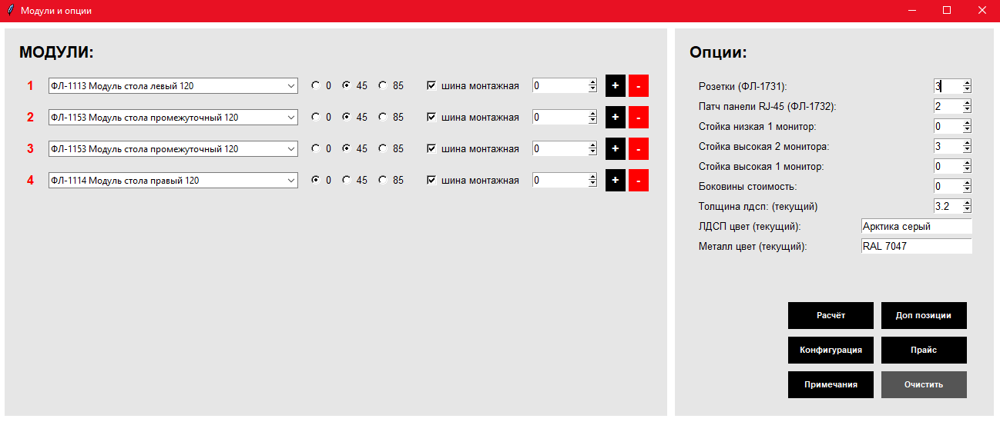
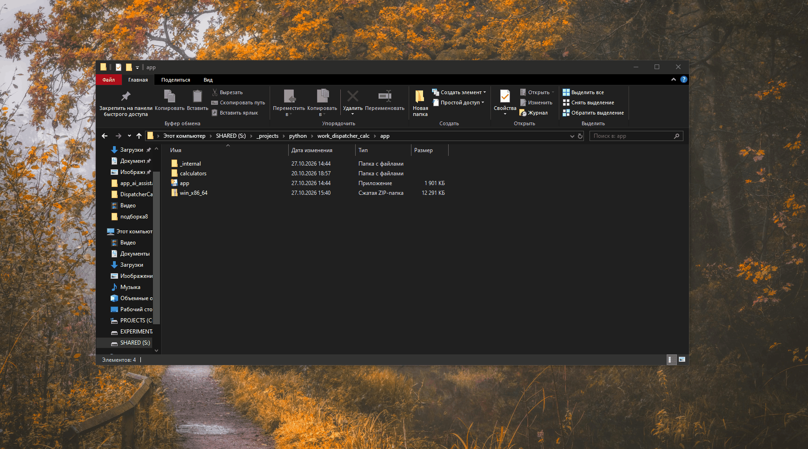

# Калькулятор диспетчерской мебели

> Цены в прайсе изменены на вымышленные (неразглашение коммерческой тайны).

Портфолио-проект, оставшийся с предыдущей работы (Код не предназначен для продакшена, но демонстрирует подход к
автоматизации расчётов). Будучи менеджером по закупкам в мебельной сфере, я регулярно считал себестоимость диспетчерских
столов по прайс-листам поставщиков. Расчёт был ручной и занимал ~1 час на конфигурацию (в зависимости от сложности), а
повторяющиеся паттерны в расчётах явно просились в автоматизацию.

Я написал этот калькулятор-конфигуратор, чтобы убрать рутину: время на расчёт сократилось до ~2 минут (на ввод данных).
На выходе получал готовую PDF-презентацию с расчётом и отдавал её в коммерческий отдел. В связи с ограничениями на
сторонние зависимости (официально я не был программистом, приходилось скрываться) всё реализовано на стандартной
библиотеке Python — HTML-рендеринг тоже написан вручную, без шаблонизаторов.

## Что умеет

- Конфигурирование стола из цепочки модулей (прямые, угловые 22°/90°, левые/правые/промежуточные)
- Подбор комплектующих из SQLite-прайса по длине/высоте/типу
- Расчёт ЛДСП (столешницы, боковины) по площади и цене за м²
- Опции: розетки, патч-панели, кронштейны под мониторы
- Пользовательские позиции и примечания
- Обновление прайс-листа из .txt
- GUI на tkinter + HTML-рендер результата (для печати в PDF)

Доступен [релиз](https://github.com/Mike2024New/work-dispatcher-calc/releases/download/1.0.0/win_x86_64.zip), вы можете
запустить его как обычное приложение, и посмотреть руками.

## Стек

Python 3.12, tkinter, SQLite, HTML/CSS.

## Примечание

- Цены в прайсе изменены на вымышленные (неразглашение коммерческой тайны).
- База `dispatcher_price.db` добавлена в репозиторий осознанно: не содержит секретных данных, нужна для запуска «из
  коробки» как пример.
- Проект сохранен в оригинальной редакции лето 2025 (момент моего ухода из компании) с незначительными правками (
  добавлены модули пакета infrastructure2 для более удобного управления путями и сборками).